# MADAR TV v4 review gallery

These are native Flutter widget renders with sample data, not physical-TV playback captures. The full application uses the same widgets. Public production profiles default to history off; the explicit demo uses session-only sample progress and recommendations.

## home

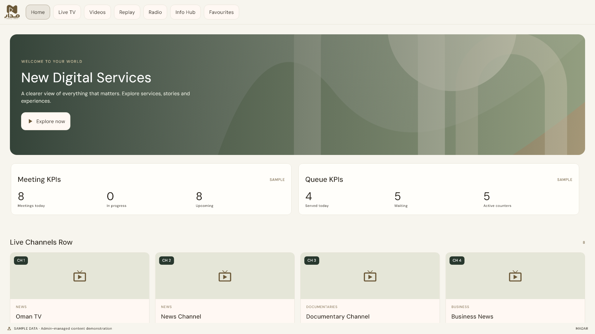

## info hub portrait

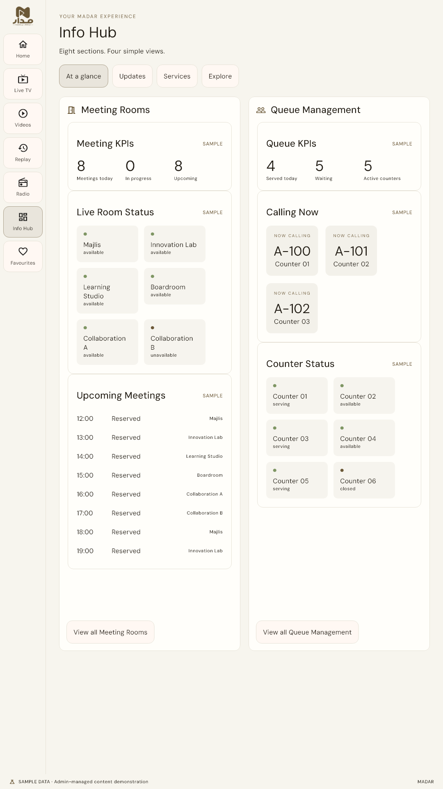

## info hub

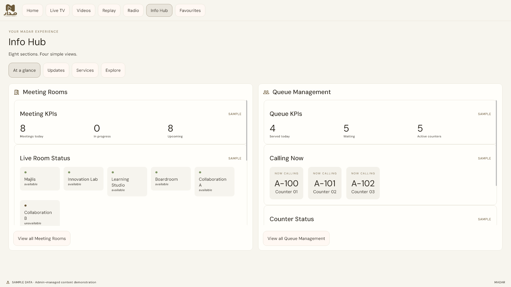

## info meetings

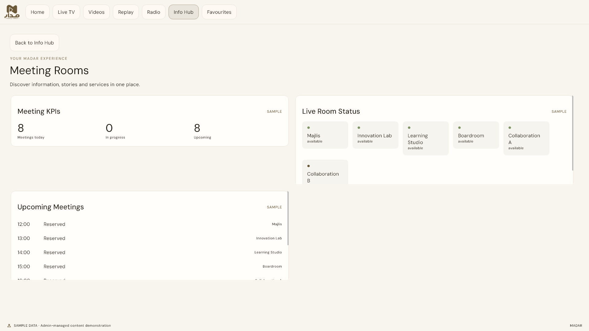

## live tv portrait

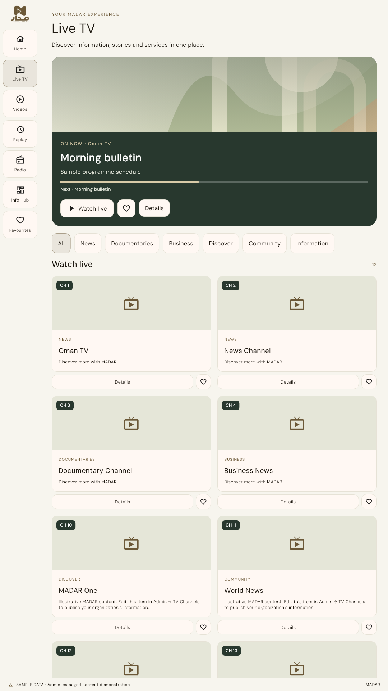

## live tv

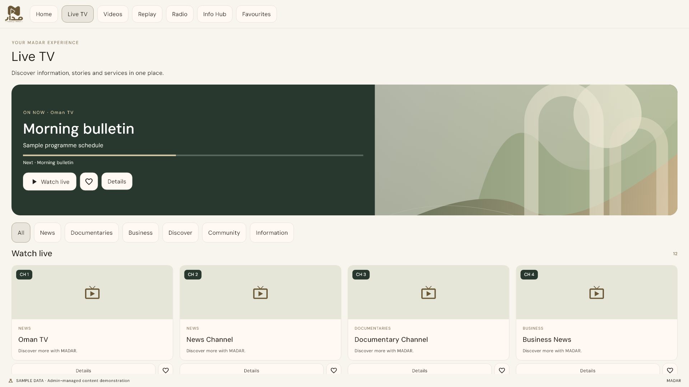

## replay portrait

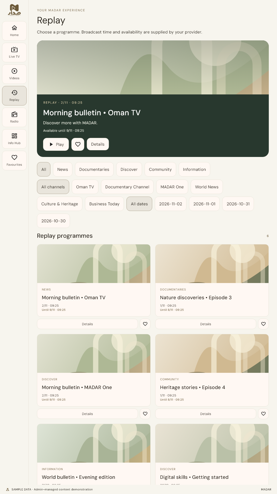

## replay

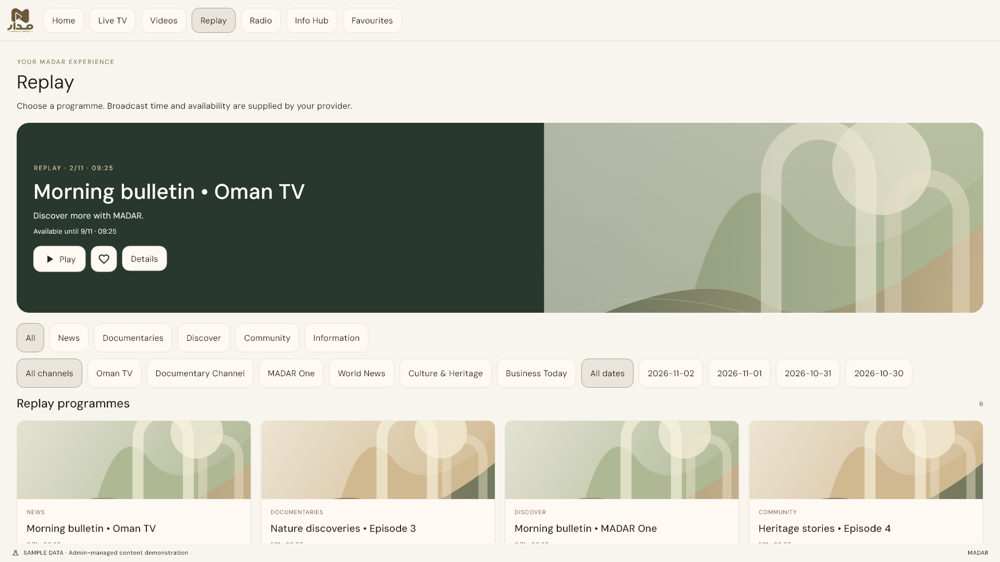

## videos portrait ar

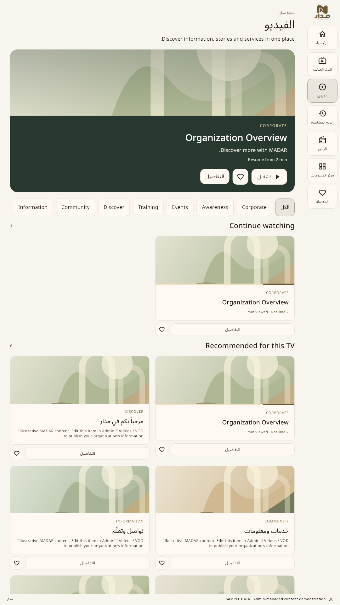

## videos portrait

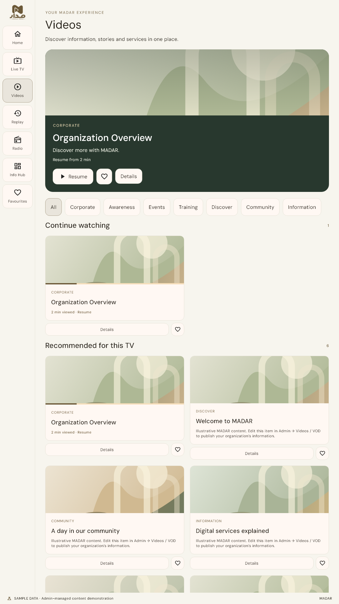

## videos

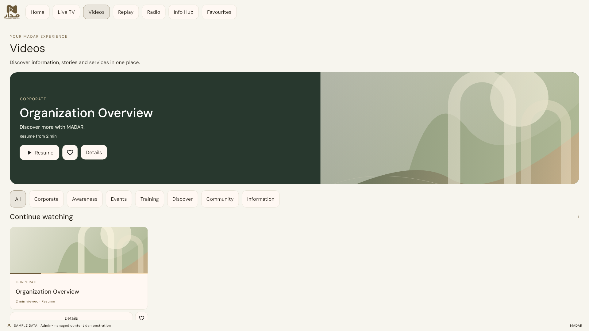
